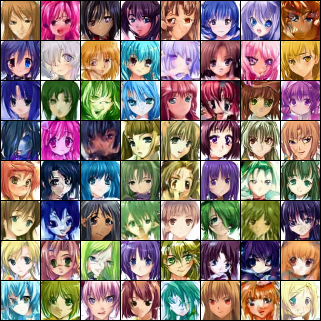
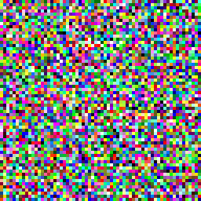
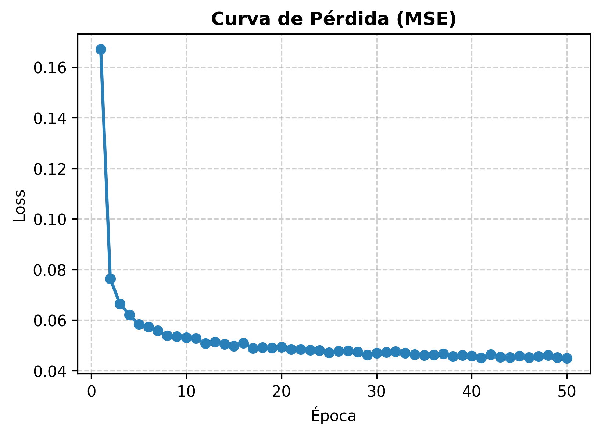
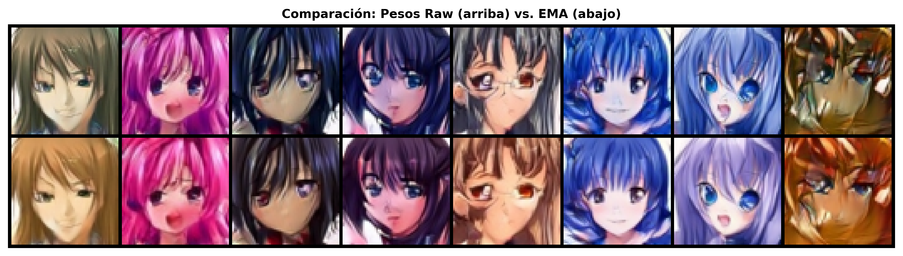
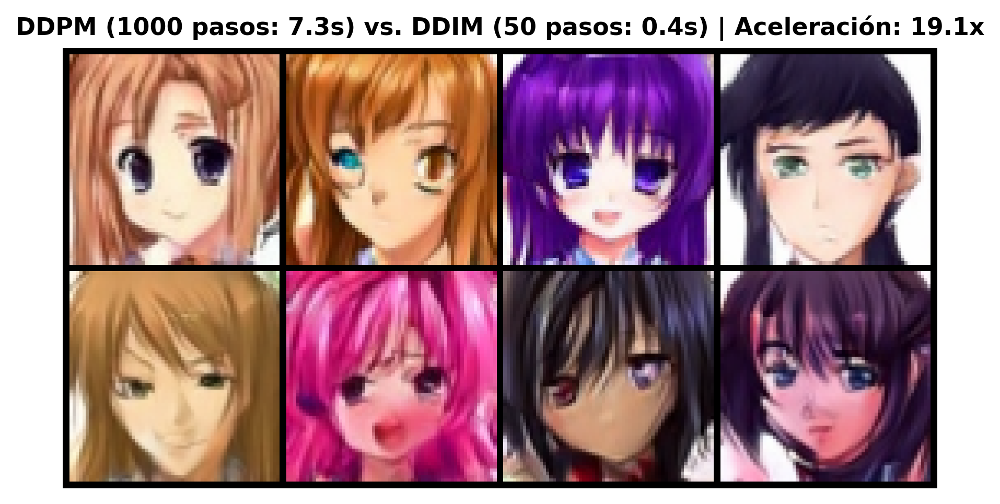

# Noise2Waifu
Generación de rostros de anime (64×64) mediante Modelos de Difusión Condicional (`DDPM / DDIM`) entrenados desde cero en PyTorch sobre [Anime Face Dataset](https://www.kaggle.com/datasets/splcher/animefacedataset).

## Integrantes
- Diego Pineda Garcia
- Ivan Urbano Nieves

## Notebook
[Link al notebook](https://colab.research.google.com/drive/1Ourhz2p1nw4poGddhchT3dV-hic404Rm?usp=sharing)

## Adaptaciones y Mejoras Implementadas
- **U-Net condicional:** 16,630,531 parámetros (`base=64`, multiplicadores `1, 2, 4, 8`), embeddings sinusoidales de tiempo `t`, `GroupNorm(8) + SiLU` y `Self-Attention` selectiva en `16×16`.
- **Schedule Coseno:** Mejor preservación estructural en pasos intermedios frente al schedule lineal para `64×64`.
- **Pesos EMA (`decay=0.999`):** Suavizado exponencial guardado junto al modelo en el mismo checkpoint sin costo en inferencia.
- **Muestreo acelerado DDIM (`50` pasos, `eta=0.0`):** Inferencia determinista sobre el mismo modelo entrenado con acotamiento de $\hat{x}_0 \in [-1, 1]$.

## Ejecución local

```bash
python3 -m venv .venv
source .venv/bin/activate
pip install -r requirements.txt
python train.py --epochs 2 --max_images 64
python sample.py --ckpt outputs/checkpoints/ckpt_latest.pt
```

## Entrenamiento

1. Abrir el notebook en [Google Colab](https://colab.research.google.com/drive/1Ourhz2p1nw4poGddhchT3dV-hic404Rm?usp=sharing)
2. Montar Google Drive para guardar los checkpoints y resultados
3. Ejecutar todas las celdas en orden para descargar el dataset, entrenar el modelo y generar las figuras

## Métricas y Resultados

- **Dataset entrenado:** **30,000** imágenes (`64×64×3`, rango `[-1, 1]`)
- **Pérdida MSE (Época 1 → Época 50):** **0.167045 → 0.044889**
- **Velocidad de muestreo (4 imágenes en L4):** DDPM (1000 pasos) **7.3 s** vs. DDIM (50 pasos) **0.4 s** (**19.1× más rápido**)

### Grilla Final (64 rostros · EMA + DDIM 50 pasos)


### Proceso de Denoising Progresivo


### Curva de Aprendizaje (MSE en 50 epochs)


### Comparativa de Calidad: Pesos Raw vs EMA


### Comparativa de Velocidad y Estabilidad: DDPM vs DDIM

